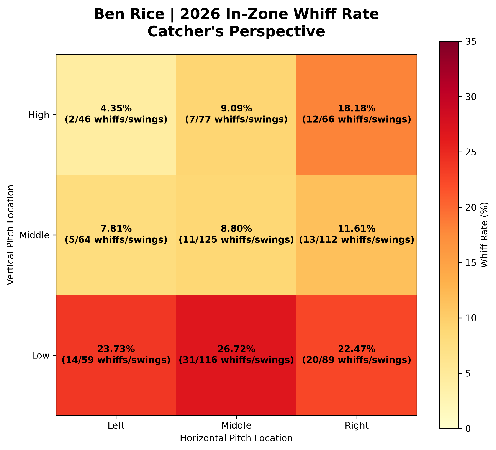

<<<<<<< HEAD
# Ben Rice | 2026 Hitter Weakness & Matchup Analysis

## Project Overview

This project uses MLB Statcast pitch-level data to analyze Ben Rice's swing-and-miss tendencies, pitch-type matchups, strike-zone weaknesses, and contact quality during the 2026 regular season.

The objective is to translate baseball data into actionable insights that could support advance scouting and pitcher game planning.

## Scouting Visualization



*In-zone whiff rate by approximate strike-zone location, displayed from the catcher's perspective.*

## Tools & Technologies

- **Python:** pybaseball, pandas, NumPy, Matplotlib
- **SQL:** PostgreSQL
- **Database Management:** pgAdmin / VS Code
- **Data Source:** MLB Statcast via pybaseball

## Dataset

- 2,695 pitches analyzed
- 154 games
- 11 pitch types
- 1,157 swings
- 294 whiffs
- 25.41% overall whiff rate

The dataset covers the 2026 MLB regular season. Pitch-level data was downloaded through pybaseball and filtered to regular-season games.

## Key Findings

**1. Below-zone vulnerability**

Rice recorded a 54.50% whiff rate on 200 swings at pitches below the strike zone. His swing rate on these pitches was 25.71%.

**2. Slider effectiveness**

Sliders generated a 35.96% overall whiff rate. Sliders finishing below the zone generated a 61.54% whiff rate against left-handed pitchers and 62.96% against right-handed pitchers.

**3. Right-handed curveballs**

Curveballs below the strike zone generated a 65.22% whiff rate on 23 swings against right-handed pitchers.

**4. Four-seam fastball contact**

Rice averaged 96.29 mph exit velocity and a .609 estimated contact value on 88 tracked balls put in play against four-seam fastballs.

**5. Strike-zone location**

The lower third of the strike zone generated a 24.62% whiff rate, compared with 9.97% in the middle third.

## Scouting Implications

The analysis suggests that breaking balls finishing below the strike zone may be useful for generating swings and misses against Rice, particularly in appropriate count situations.

Sliders below the zone generated high whiff rates against both left-handed and right-handed pitchers. Right-handed curveballs below the zone also showed promising results.

Pitchers should be cautious about leaving hittable offerings in the middle of the strike zone, where Rice demonstrated strong contact quality.

These findings are descriptive and should be interpreted alongside sample sizes, pitch sequencing, count, and pitcher-specific characteristics.

## Methodology

Pitch-level data was collected using pybaseball, imported into PostgreSQL, and analyzed using SQL queries.

Swing and whiff rates were calculated using Statcast pitch descriptions:

- **Swing rate:** Swings divided by total pitches
- **Whiff rate:** Whiffs divided by swings
- **Swings:** `swinging_strike`, `swinging_strike_blocked`, `foul_tip`, `foul`, and `hit_into_play`
- **Whiffs:** `swinging_strike`, `swinging_strike_blocked`, and `foul_tip`

Strike-zone locations were grouped into approximate zones using `plate_x`, `plate_z`, and batter-specific `sz_top` and `sz_bot` measurements. Horizontal location labels use the catcher's perspective.

For pitch-location categories, pitches below or above the strike zone were classified vertically before evaluating whether they were horizontally outside the zone. This makes the categories mutually exclusive.

Contact-quality comparisons include only balls put in play with nonmissing launch-speed and estimated-contact-value measurements. These metrics describe contact quality, not overall offensive production.

Python and Matplotlib were used to create the visualizations.

## Project Structure

```text
Ben Rice Project/
├── data/
│   └── ben_rice_2026_statcast.csv
├── outputs/
│   ├── ben_rice_pitch_types.png
│   ├── ben_rice_whiff_heatmap.png
│   └── ben_rice_zone_comparison.png
├── reports/
│   └── Ben_Rice_Scouting_Report.pdf
├── scripts/
│   ├── Ben_Rice.py
│   ├── Load_Ben_Rice_SQL.py
│   ├── Ben_Rice_Heatmap.py
│   └── Ben_Rice_Zone_Comparison.py
├── sql/
│   └── Ben_Rice_Analysis.sql
├── .gitignore
├── README.md
└── requirements.txt
```

## Reproducing the Analysis

### 1. Prerequisites

Install Python, PostgreSQL, and Git. A code editor such as VS Code and a PostgreSQL client such as pgAdmin are recommended.

### 2. Clone the Repository

```bash
git clone https://github.com/AlexEro99/ben-rice-2026-scouting-analysis.git
cd ben-rice-2026-scouting-analysis
```

### 3. Install Python Dependencies

```bash
python -m pip install -r requirements.txt
```

### 4. Download Statcast Data

```bash
python scripts/Ben_Rice.py
```

This script downloads Ben Rice's 2026 regular-season Statcast data, saves the dataset in the `data/` directory, and generates the pitch-type visualization.

### 5. Create the PostgreSQL Database

Create a local PostgreSQL database named:

```sql
CREATE DATABASE baseball_analytics;
```

Use pgAdmin or another PostgreSQL client to create the database before running the loading script.

### 6. Load the Dataset into PostgreSQL

```bash
python scripts/Load_Ben_Rice_SQL.py
```

The script prompts for the local PostgreSQL password and loads the CSV into the `ben_rice_pitches` table.

If the table already contains data, the script skips the import to avoid duplicating records.

### 7. Run the SQL Analysis

Open `sql/Ben_Rice_Analysis.sql` in pgAdmin or another PostgreSQL client connected to the `baseball_analytics` database.

Execute the queries to reproduce the pitch-type, handedness, strike-zone, below-zone, and contact-quality analyses.

### 8. Generate Visualizations

```bash
python scripts/Ben_Rice_Heatmap.py
python scripts/Ben_Rice_Zone_Comparison.py
```

These scripts generate the in-zone whiff heatmap and vertical strike-zone comparison chart.

**Note:** The heatmap and zone-comparison scripts currently use validated aggregate values from the SQL analysis. If the underlying dataset changes, update those values before regenerating the charts.

## Project Deliverables

- [Advance Scouting Report (PDF)](reports/Ben_Rice_Scouting_Report.pdf)
- [In-Zone Whiff Heatmap](outputs/ben_rice_whiff_heatmap.png)
- [Strike-Zone Comparison](outputs/ben_rice_zone_comparison.png)
- [Pitch Types Faced](outputs/ben_rice_pitch_types.png)
- [SQL Analysis](sql/Ben_Rice_Analysis.sql)

## Limitations

This is an exploratory scouting analysis based on one season of pitch-level data.

Some pitch-type and matchup comparisons contain small samples. Contact-value metrics describe balls put in play rather than overall offensive production, and strike-zone boundaries are approximations.

=======
# Ben Rice | 2026 Hitter Weakness & Matchup Analysis

## Project Overview

This project uses MLB Statcast pitch-level data to analyze Ben Rice's swing-and-miss tendencies, pitch-type matchups, strike-zone weaknesses, and contact quality during the 2026 regular season.

The objective is to translate baseball data into actionable insights that could support advance scouting and pitcher game planning.

## Scouting Visualization


*In-zone whiff rate by approximate strike-zone location, displayed from the catcher's perspective.*

## Tools & Technologies

- **Python:** pybaseball, pandas, NumPy, Matplotlib
- **SQL:** PostgreSQL
- **Database Management:** pgAdmin / VS Code
- **Data Source:** MLB Statcast via pybaseball

## Dataset

- 2,695 pitches analyzed
- 154 games
- 11 pitch types
- 1,157 swings
- 294 whiffs
- 25.41% overall whiff rate

The dataset covers the 2026 MLB regular season. Pitch-level data was downloaded through pybaseball and filtered to regular-season games.

## Key Findings

**1. Below-zone vulnerability**

Rice recorded a 54.50% whiff rate on 200 swings at pitches below the strike zone. His swing rate on these pitches was 25.71%.

**2. Slider effectiveness**

Sliders generated a 35.96% overall whiff rate. Sliders finishing below the zone generated a 61.54% whiff rate against left-handed pitchers and 62.96% against right-handed pitchers.

**3. Right-handed curveballs**

Curveballs below the strike zone generated a 65.22% whiff rate on 23 swings against right-handed pitchers.

**4. Four-seam fastball contact**

Rice averaged 96.29 mph exit velocity and a .609 estimated contact value on 88 tracked balls put in play against four-seam fastballs.

**5. Strike-zone location**

The lower third of the strike zone generated a 24.62% whiff rate, compared with 9.97% in the middle third.

## Scouting Implications

The analysis suggests that breaking balls finishing below the strike zone may be useful for generating swings and misses against Rice, particularly in appropriate count situations.

Sliders below the zone generated high whiff rates against both left-handed and right-handed pitchers. Right-handed curveballs below the zone also showed promising results.

Pitchers should be cautious about leaving hittable offerings in the middle of the strike zone, where Rice demonstrated strong contact quality.

These findings are descriptive and should be interpreted alongside sample sizes, pitch sequencing, count, and pitcher-specific characteristics.

## Methodology

Pitch-level data was collected using pybaseball, imported into PostgreSQL, and analyzed using SQL queries.

Swing and whiff rates were calculated using Statcast pitch descriptions:

- **Swing rate:** Swings divided by total pitches
- **Whiff rate:** Whiffs divided by swings
- **Swings:** `swinging_strike`, `swinging_strike_blocked`, `foul_tip`, `foul`, and `hit_into_play`
- **Whiffs:** `swinging_strike`, `swinging_strike_blocked`, and `foul_tip`

Strike-zone locations were grouped into approximate zones using `plate_x`, `plate_z`, and batter-specific `sz_top` and `sz_bot` measurements. Horizontal location labels use the catcher's perspective.

For pitch-location categories, pitches below or above the strike zone were classified vertically before evaluating whether they were horizontally outside the zone. This makes the categories mutually exclusive.

Contact-quality comparisons include only balls put in play with nonmissing launch-speed and estimated-contact-value measurements. These metrics describe contact quality, not overall offensive production.

Python and Matplotlib were used to create the visualizations.

## Project Structure

```text
Ben Rice Project/
├── data/
│   └── ben_rice_2026_statcast.csv
├── outputs/
│   ├── ben_rice_pitch_types.png
│   ├── ben_rice_whiff_heatmap.png
│   └── ben_rice_zone_comparison.png
├── reports/
│   └── Ben_Rice_Scouting_Report.pdf
├── scripts/
│   ├── Ben_Rice.py
│   ├── Load_Ben_Rice_SQL.py
│   ├── Ben_Rice_Heatmap.py
│   └── Ben_Rice_Zone_Comparison.py
├── sql/
│   └── Ben_Rice_Analysis.sql
├── .gitignore
├── README.md
└── requirements.txt
```

## Reproducing the Analysis

### 1. Prerequisites

Install Python, PostgreSQL, and Git. A code editor such as VS Code and a PostgreSQL client such as pgAdmin are recommended.

### 2. Clone the Repository

```bash
git clone https://github.com/AlexEro99/ben-rice-2026-scouting-analysis.git
cd ben-rice-2026-scouting-analysis
```

### 3. Install Python Dependencies

```bash
python -m pip install -r requirements.txt
```

### 4. Download Statcast Data

```bash
python scripts/Ben_Rice.py
```

This script downloads Ben Rice's 2026 regular-season Statcast data, saves the dataset in the `data/` directory, and generates the pitch-type visualization.

### 5. Create the PostgreSQL Database

Create a local PostgreSQL database named:

```sql
CREATE DATABASE baseball_analytics;
```

Use pgAdmin or another PostgreSQL client to create the database before running the loading script.

### 6. Load the Dataset into PostgreSQL

```bash
python scripts/Load_Ben_Rice_SQL.py
```

The script prompts for the local PostgreSQL password and loads the CSV into the `ben_rice_pitches` table.

If the table already contains data, the script skips the import to avoid duplicating records.

### 7. Run the SQL Analysis

Open `sql/Ben_Rice_Analysis.sql` in pgAdmin or another PostgreSQL client connected to the `baseball_analytics` database.

Execute the queries to reproduce the pitch-type, handedness, strike-zone, below-zone, and contact-quality analyses.

### 8. Generate Visualizations

```bash
python scripts/Ben_Rice_Heatmap.py
python scripts/Ben_Rice_Zone_Comparison.py
```

These scripts generate the in-zone whiff heatmap and vertical strike-zone comparison chart.

**Note:** The heatmap and zone-comparison scripts currently use validated aggregate values from the SQL analysis. If the underlying dataset changes, update those values before regenerating the charts.

## Project Deliverables

- [Advance Scouting Report (PDF)](reports/Ben_Rice_Scouting_Report.pdf)
- [In-Zone Whiff Heatmap](outputs/ben_rice_whiff_heatmap.png)
- [Strike-Zone Comparison](outputs/ben_rice_zone_comparison.png)
- [Pitch Types Faced](outputs/ben_rice_pitch_types.png)
- [SQL Analysis](sql/Ben_Rice_Analysis.sql)

## Limitations

This is an exploratory scouting analysis based on one season of pitch-level data.

Some pitch-type and matchup comparisons contain small samples. Contact-value metrics describe balls put in play rather than overall offensive production, and strike-zone boundaries are approximations.

Observed differences should not be interpreted as causal effects or guarantees of future pitch effectiveness. Results may also be influenced by pitcher quality, pitch sequencing, count, and game situation.
